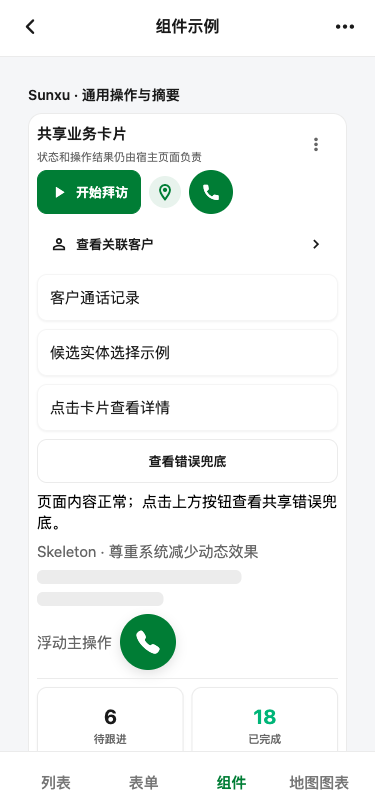

# IconActionButton 紧凑尺寸修复验收

## 结果

Expo Web Catalog 的组件几何检查通过：显式传入 `ControlSize.iconButton` 后，按钮布局框为 32×32；未传 `size` 的按钮保持 44×44。两者在 375×812、320×720 和 812×375 视口均保持 8px 间距。原生 iOS/Android 的实际触控范围标记为 `UNVERIFIED`。Tel App 公海页和来电页需要登录；本次没有用户确认的测试会话，这些真实页面的运行时验收标记为 `BLOCKED`，没有尝试进入登录态。

## 修复

`IconActionButton.size` 现在只控制布局框，不再被组件内部 44dp 最小宽高覆盖。触控扩展仍由 `hitSlop` 提供；组件根据平台要求至少保持 iOS 44pt、Android 48dp。对于 32dp 尺寸，现有每边 8dp 的扩展分别形成 48dp 热区，满足两个平台的最小要求。

Tel App 已有的 `AnnouncementBanner` 用 `ControlSize.iconButton` 控制暂停/继续动作，无需改页面样式即可消费修复后的 32dp 布局尺寸。以源码计算，普通公告栏外框占高约 62dp；嵌入来电页头时，页头行约 49dp。Tel App 真实屏幕未在本次渲染。

## 渲染证据

页面为本地公开 Expo Web Catalog `/`，选中“组件页面示例”后测量 `Sunxu · 通用操作与摘要` 的图标动作行。Playwright 脚本只导航一次，再在同一页面切换三个视口。

| 视口 | 紧凑按钮 | 默认按钮 | 横向页面溢出 |
|---|---:|---:|---:|
| 375×812 | 32×32 | 44×44 | 无 |
| 320×720 | 32×32 | 44×44 | 11px（Catalog 其他内容；本次控制行右边界为 283px） |
| 812×375 | 32×32 | 44×44 | 无 |

320px 视口下整个 Catalog 的 `scrollWidth` 为 331px；目标按钮行本身在 283px 内结束。该页面级溢出不由本次按钮尺寸改动引起，也未扩展为修复范围。

完整矩形、截图 SHA-256、相邻间距和执行命令见 [spacing-audit.json](./spacing-audit.json)。

## 检查

- `npm run typecheck`（Sunxu）：通过。
- `git diff --check`（Sunxu）：通过。
- `node run.js /tmp/playwright-icon-action-compact.js`：成功，页面错误为空；按钮无障碍角色为 `button`，名称为“查看路线示例”。
- `python3 /Users/suconnect/.codex/skills/ui-ux-pro-max/scripts/validate_spacing_audit.py docs/verification/icon-action-button-compact-2026-11-10/spacing-audit.json`：通过，3 个视口 seam 均为 `PASS`。

## 未验证

- iOS / Android 原生布局与 `hitSlop` 实际命中范围。
- **BLOCKED**：Tel App 公海页、来电页和个人页的真实路由渲染需要用户确认可用的测试会话，或提供脱敏截图。
- 动态字体下的本地化长文案布局；本次组件只测量固定 icon action 控件。
