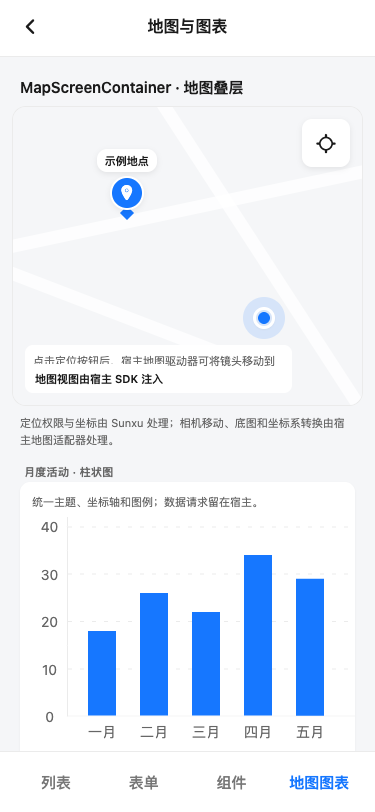
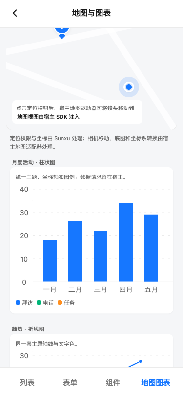
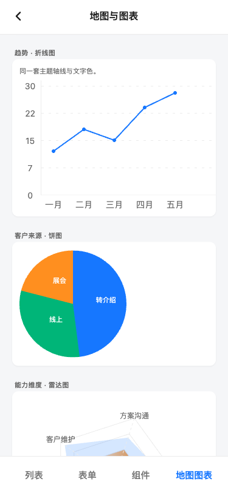
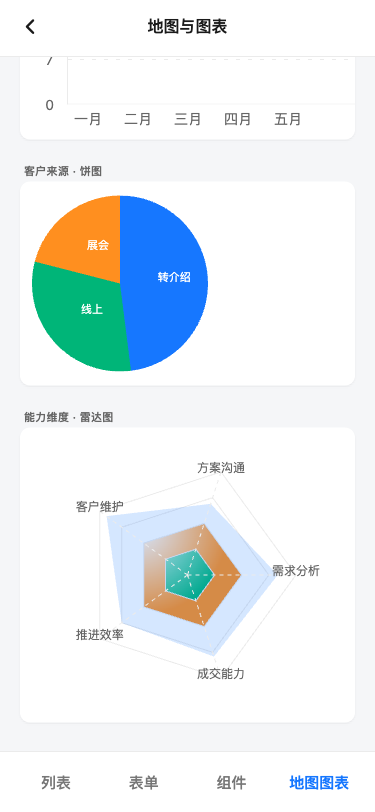
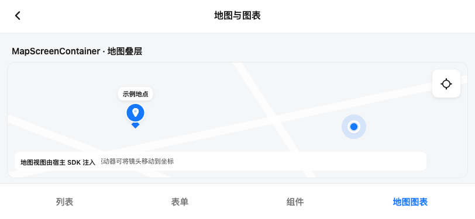

# 地图与图表组件渲染验收

日期：2026-11-06
路由：Expo Web catalog 的“地图图表”页签（`/`）
渲染：静态 Expo Web export，以 Playwright Chromium 访问 `http://localhost:8091/`。底图是 catalog 标注的宿主 SDK 注入示意图。

## 检查结果

- Sunxu 与 catalog TypeScript 检查通过；Expo Web catalog 导出成功。
- 375×812 竖屏和 812×375 横屏均实际渲染。两个视口的 `document.scrollWidth` 都与 `clientWidth` 相同，没有页面级横向溢出。
- 地图容器在竖屏为 351×300 px；定位按钮为 48×48 px。模拟授权后的浏览器定位返回 `31.23040, 121.47370`，按钮回调文本更新成功，页面错误为 0。此项使用 Playwright 模拟坐标和浏览器授权，没有请求设备真实定位。
- 横屏地图画布为 788×199 px（x=12–800，y=106–305），完整显示在滚动区底部 y=314 之前；底部导航触控区域为 72×44 px。
- 柱状图、折线图、饼图和雷达图均在页面生成 SVG（共 13 个）；竖屏截图分别覆盖地图/柱图、完整柱图、完整折线图以及饼图/雷达图。页面滚动区为 375 px 宽，固定导航保持可见。
- DOM 几何与像素间距核对见 [maps-charts-spacing.json](./maps-charts-spacing.json)，间距校验器结果为 `PASS`（3 条 seam）。其中地图标题到地图、地图到说明各 8 px，对应 `Spacing.sm`；图表标题到卡片为 3 px，对应 `DetailCard.titleRow` 契约。
- 静态预览控制台有 1 条 `/favicon.ico` 404（catalog 未配置 favicon）；无页面运行异常。该请求不影响页面内容。

## 截图

竖屏首屏（地图、当前位置标记、定位按钮与柱状图）：

柱状图卡片和图例：

折线图和饼图：

饼图和雷达图：

横屏地图画布与底部导航：

## 验收边界

浏览器用示意底图验收了通用插槽、标记、控件和图表；没有加载任何地图厂商 SDK。iOS/Android 的安全区、厂商 Marker 和相机动画还需宿主选择地图 SDK 后进行设备验收。真实设备定位权限弹窗也未在本次浏览器验收中触发。
