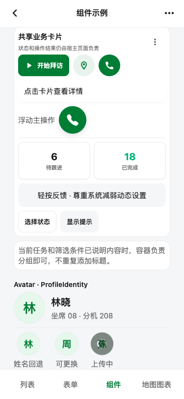
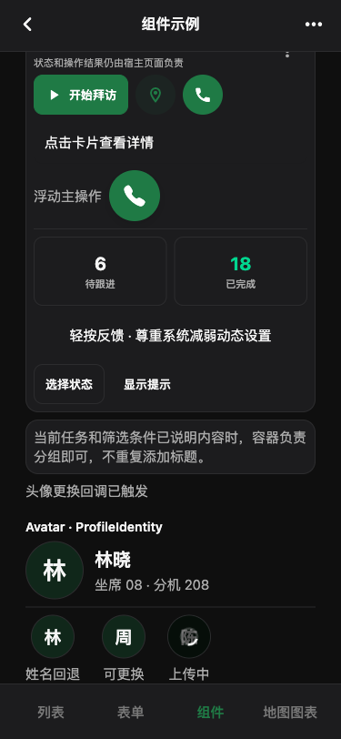
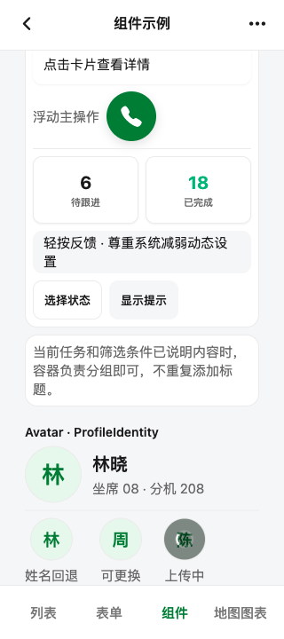

# Avatar 与 ProfileIdentity 验收

## 结果

**Expo Web Catalog 验收通过；原生端仍为 UNVERIFIED。** 新增组件在 375×812、320×720 和 812×375 CSS px 下完成浅色渲染，375×812 下完成深色渲染。身份行头像与文字列间距均为 `Spacing.md` 的 12px；头像点击回调、忙碌禁用态及 `aria-busy="true"` 已实际观察。以上是 Sunxu Catalog 的组件级证据，不代表东健 CRM 或 Tel App 的真实资料页已经接入。

## 设计职责

- `Avatar` 展示头像 URL 或姓名首字回退，并提供可选宿主动作。资料选择、裁剪、上传、权限和错误提示由宿主负责。
- `ProfileIdentity` 组合 64px 默认头像、姓名和 `metadata` 插槽。CRM 可传入组织/职位等真实字段；Tel App 可传入坐席/分机等电话身份字段。Sunxu 不限定字段，也不读取账号、权限或导航。
- 图片 URL 成功/失败加载和原生图片解码依赖宿主实际资源；本次没有接入 CRM/Tel 认证数据或外部头像 URL。

## 渲染与几何

渲染路径为静态 Expo Web Catalog，地址 `http://localhost:8082/`，进入“组件页面示例”并滚动至 `Avatar · ProfileIdentity`。

| 视口 | 身份行 | 头像到文字间距 | 页面横向宽度 | 组件滚动区 |
|---|---:|---:|---:|---:|
| 375×812 | 319×64 | 12px | 375/375，无溢出 | 375/375，无溢出 |
| 320×720 | 264×64 | 12px | 320/320，无溢出 | 320/320，无溢出 |
| 812×375 | 756×64 | 12px | 812/812，无溢出 | 812/812，无溢出 |

DOM 矩形、滚动宽度和访问属性见 [geometry.json](./geometry.json)；间距视觉观察与截图校验见 [spacing-audit.json](./spacing-audit.json)。

### 375×812 浅色

### 375×812 深色

### 320×720 窄屏

## 交互证据

- 可更换头像按下后，Catalog 显示宿主回调反馈“头像更换回调已触发”。
- 忙碌头像呈现 spinner，DOM 按钮 `aria-disabled="true"`、`aria-busy="true"`；加载中不能重复触发。
- `ProfileIdentity` 头像标签是“更换林晓的头像”。
- 浏览器控制台和页面错误均为空。

## 验证命令

- `npm run typecheck`：通过。
- `npx expo export --platform web --output-dir /tmp/sunxu-profile-identity-dist`：通过。
- `/Users/suconnect/.codex/skills/playwright-skill/run.js /tmp/playwright-profile-identity.js`：成功运行真实页面交互、截图和 DOM 几何检查。
- `python3 /Users/suconnect/.codex/skills/ui-ux-pro-max/scripts/validate_spacing_audit.py docs/verification/profile-identity-2026-11-10/spacing-audit.json`：通过，3 个视口 seam 均为 `PASS`。

## 未验证项

- 东健 CRM 与 Tel App 的真实个人资料路由、接口字段和头像上传链路尚未接入；这里完成的是两端可共用的 UI 契约与 Catalog 示例。
- iOS/Android 原生设备、系统读屏和大字体档位未核对。
- 有效头像 URL 成功显示和图片加载失败后的首字回退未通过真实网络/资源 fixture 实测。
