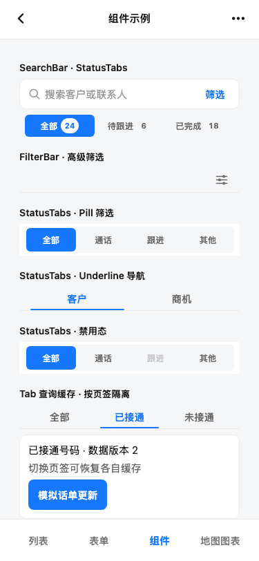

# Tab 查询缓存验收

## 运行条件

- 页面：Sunxu Expo Web Catalog →「组件」→「Tab 查询缓存 · 按页签隔离」
- 视口：375 × 812 CSS px
- 数据：Catalog 内的本地模拟话单，不连接 Tel API
- 结果：依次打开「全部」和「已接通」均得到版本 1；切回「全部」恢复版本 1 缓存；点击「模拟话单更新」后，当前页签变为版本 2；再打开已接通页签也请求并显示版本 2。
- 浏览器控制台与页面运行错误：0

## 页面几何

目标组件在截图视口内，宽度 319 px，无水平溢出（`scrollWidth === clientWidth`）。完整几何和组件可见文案见 [geometry.json](./geometry.json)。

本记录只验证 Web Catalog 的模拟状态、Tab 缓存恢复与失效入口。Tel 真实认证路由、真实接口错误恢复、iOS/Android 生命周期及原生触控仍为 **UNVERIFIED**。
