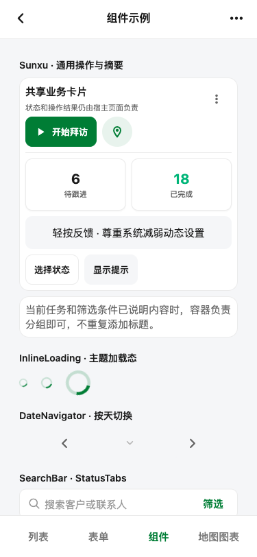

# Sunxu 0.1.9 Catalog 组件核验

## 结果

**PASS WITH UNVERIFIED。** 当前源码在 Expo Web Catalog 的 375×812 视口下，显示 CRM 绿色主操作、标题/无标题分组和绿色选中状态；快捷筛选展开、选项切换和回到默认值的交互已观察。页面宽度与内容滚动宽度一致。快捷筛选展开态截图未归档，Catalog Web 不替代 Android/iOS 原生验收，深色主题也未在本次重新核对。

## 渲染路径与变更

- 路由：Expo Web Catalog `http://localhost:8097/`，组件示例页。
- 视口：375×812 CSS px，浅色主题。
- `SectionCard.title` 改为可选；无标题、无副标题、无右侧操作时不渲染 header 或 header 间距。
- `StatusTabs.TabItem.accessibilityHint` 只提供给读屏，不产生可见解释行。
- 默认主题色为 CRM 绿；Catalog 的当前 Tab 从 `colors.primary` 读取。
- `FilterBar.includeAllOption: false` 隐藏“全部”选项。展开后实际看到“今天 / 近 3 天 / 本周”；选择“近 3 天”后快捷控件标签更新，最后恢复“今天”。

## 截图与几何

初始视口截图显示标题卡片和无标题分组。无标题 `SectionCard` 外框为 x=28、y=432、319×60，正文为 x=37、y=441、301×42。Catalog 主滚动区为 375×694，内容高 1893；页面与滚动区均无横向溢出。快捷筛选标题、控制项、下拉选项矩形见 [geometry.json](./geometry.json)。

快捷筛选展开后的可见截图留在本次 CUA 工具记录中，但未持久化到仓库。对应标题到控件的 spacing seam 在 [spacing-audit.json](./spacing-audit.json) 中保留 `UNVERIFIED`，未将未归档的截图当作可复核文件。

## 主题与对比度

- 浅色：主色 `#007D35`、主色浅底 `#E6F7EC`。
- 深色：主色 `#1F7A45`、主色浅底 `#10271A`；本次未重跑深色主题渲染。
- 白字对比度：浅色主色 5.27:1，深色主色 5.35:1（源码 token 计算）。
- `npm run typecheck` 与 Catalog TypeScript 检查通过。

## 未验证项

- 快捷筛选展开态的持久化截图。
- 深色主题本次未重新渲染；没有深色主题截图。
- Android/iOS 原生布局、系统读屏和动态字体档位。

这些缺项保留为 `UNVERIFIED`，不把 Web Catalog 的证据外推为原生验收。
